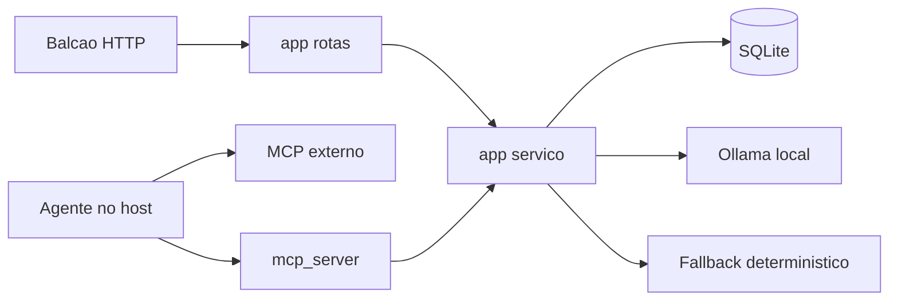

# Arquitetura da BiblioAPI

Mapa da solução. O contrato HTTP continua em `SPEC.md`. A decisão do modelo está na ADR 0003. Peças marcadas como previstas ainda não têm código.

## Visão

O balcão fala com a API HTTP. As regras de negócio moram numa camada de serviço só. O SQLite é a persistência. Dois MCPs existem, e nenhum dos dois substitui a API:

- o MCP do projeto fica em `mcp_server/` e chama o mesmo serviço que as rotas HTTP
- o MCP externo é ferramenta do agente no host, com a configuração versionada no repositório

A recomendação é o único caminho que chama modelo. O runtime é Ollama, local. Se o Ollama não responder, o serviço devolve um ranking determinístico calculado com os dados do SQLite, sem outra rede.

## Onde cada peça fica

| Peça | Lugar | Fala com | Etapa |
| --- | --- | --- | --- |
| Rotas HTTP e OpenAPI | `app/` | serviço | 1, reservas; 2, empréstimos; 3, recomendação |
| Regras de fila, empréstimo e recomendação | `app/`, camada de serviço | SQLite e, na recomendação, Ollama | mesma divisão acima |
| SQLite | arquivo no volume Docker, fora do Git | só o serviço | 1 |
| MCP próprio, pelo menos 2 tools | `mcp_server/` | serviço, não o banco e não as rotas | 2 |
| MCP externo, pelo menos 1 | config versionada do agente no repositório | o agente no host | 2 |
| Ollama | serviço local, porta 11434 | só o serviço de recomendação | 3 |
| Fallback determinístico | função no serviço de recomendação | só o SQLite | 3 |
| Skill | `.agents/skills/` | o agente | 3 |
| Hook ou regra de permissão | config da ferramenta e teste em `tests/` | o agente | 3 |
| Golden set | `evals/` | a recomendação | 4 |
| CI | `.github/workflows/` | testes, cobertura, scans | 4 |

`GET /saude` continua operacional e fora da conta dos oito endpoints de negócio.

## MCPs

O MCP próprio não é uma segunda API. As tools repetem operações que o serviço já sabe fazer, por exemplo listar o catálogo e criar uma reserva. A regra da fila fica num lugar só. O processo sobe pelo agente, em stdio, a partir de `mcp_server/`. Não entra no caminho do balcão.

O MCP externo também não entra no caminho do balcão. Ele ajuda o agente durante a construção. A configuração fica no repositório, sem segredo. A evidência de uma chamada real é artefato da etapa 2.

## Ollama

Ollama roda na mesma máquina, como processo local. Na etapa 3 o Compose ganha esse serviço. A API chama `http://ollama:11434` dentro da rede do Compose. Fora do Compose, o endereço é `http://127.0.0.1:11434`.

O nome do modelo vem da variável `OLLAMA_MODEL`. O identificador do modelo é escolhido na etapa 3, junto com o contrato fino de `POST /recomendacoes`. Timeout ou resposta inválida do Ollama não falha a requisição: o serviço usa o fallback.

O fallback não chama rede. A regra exata do ranking entra na spec antes do código da rota. A arquitetura só fixa o lugar dele: dentro do serviço, ao lado da chamada ao Ollama.

## O que isto não muda

A fila continua FIFO na própria reserva, ADR 0002. Os endpoints de negócio continuam em oito, ADR 0001. Empréstimo e recomendação não ganham rota antes da etapa de cada um.
